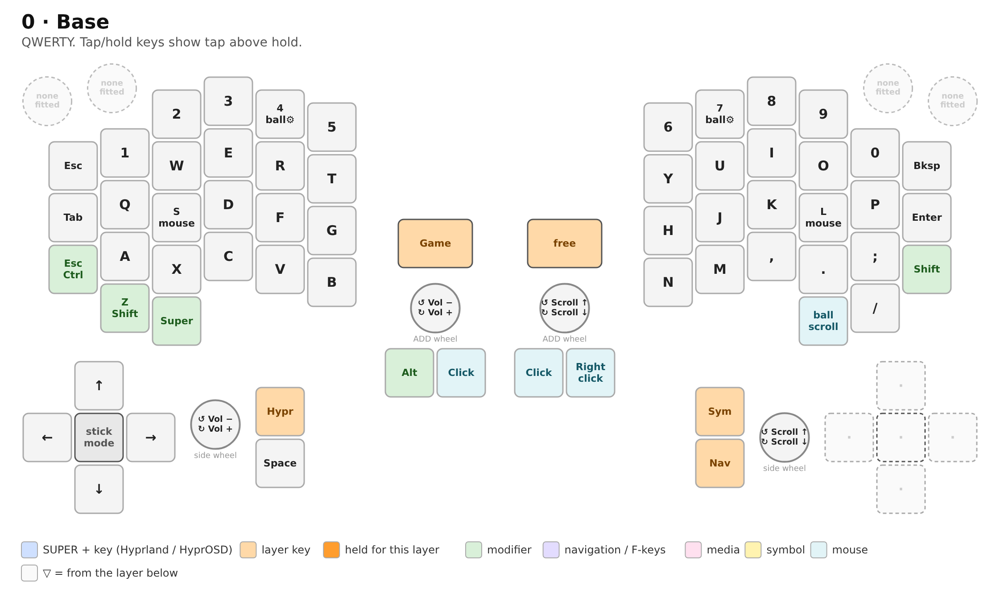
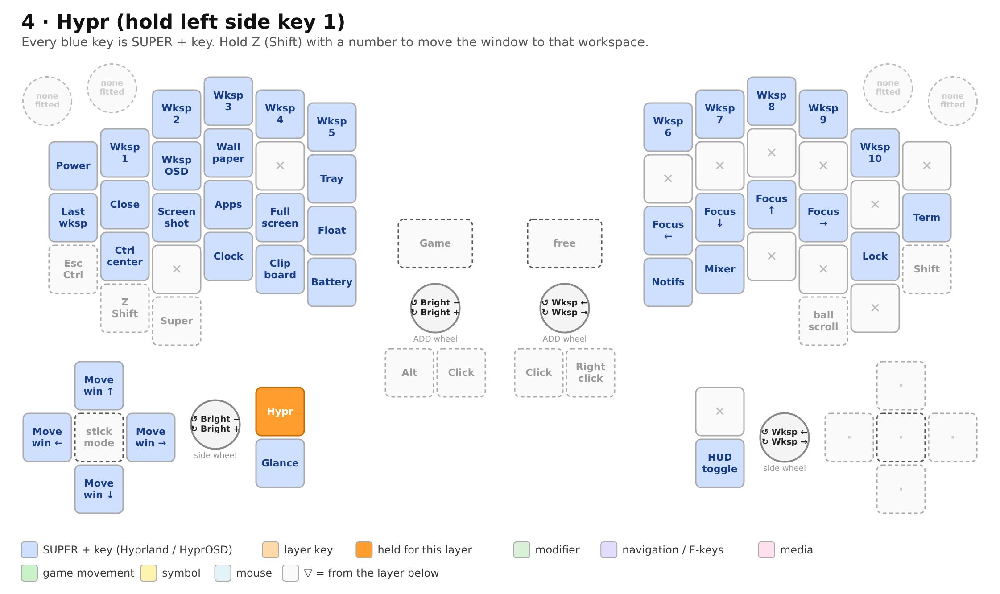
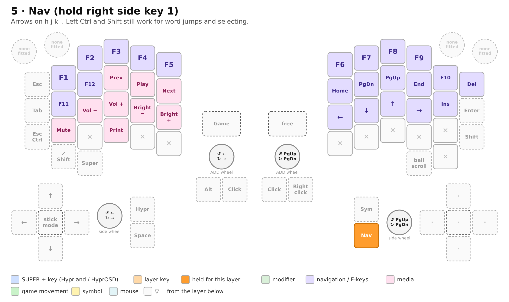
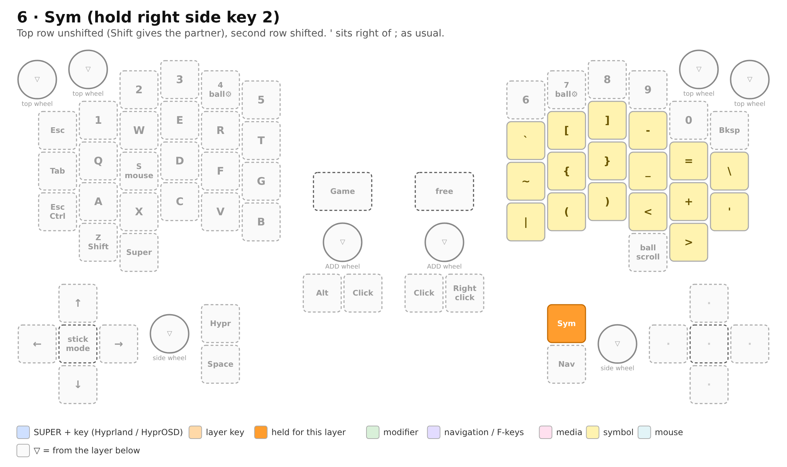
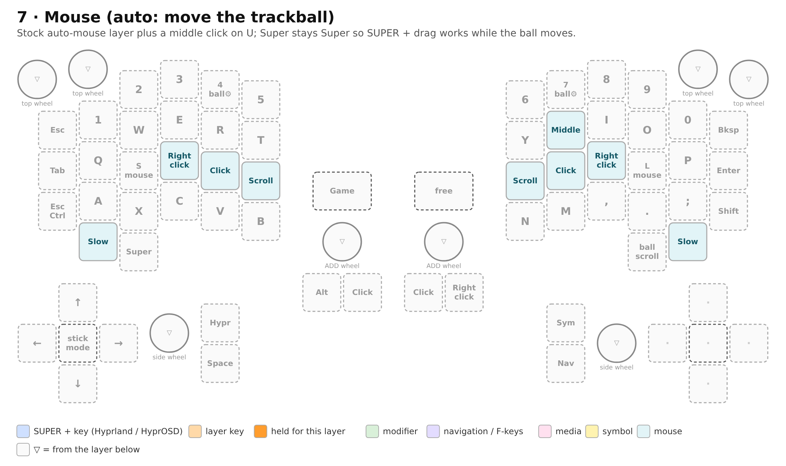
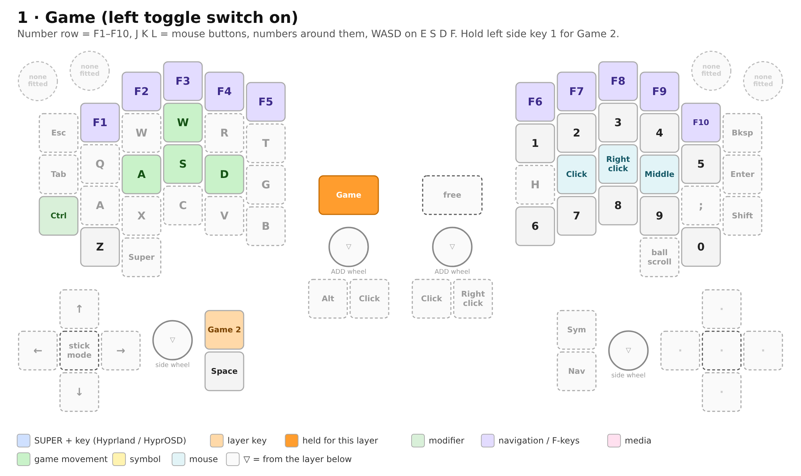
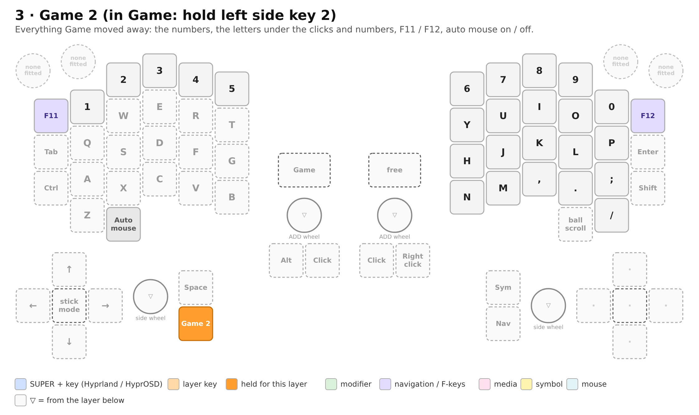

# Killer Whale layers for Hyprland + HyprOSD

A layer plan for a **Killer Whale DUO** with a **joystick on the left**, a
**trackball on the right** and an **ADD unit (two keys, a wheel, a toggle
switch) on each side**, using QWERTY, Hyprland (Lua config) and
[HyprOSD](https://github.com/Pax903/HyprOSD).

Two ways to get it onto the keyboard:

- **Custom firmware (recommended):** the whole plan is already in
  [`keymaps/hyprland/keymap.c`](../qmk_firmware/keyboards/killerwhale/duo/keymaps/hyprland/keymap.c),
  and it does one thing Remap can't: **auto mouse turns off by itself while
  the Game toggle is on**. GitHub builds the `.uf2` — see
  [Custom firmware](#custom-firmware).
- **Remap on the stock firmware:** click the layers in by hand with
  [Remap](https://remap-keys.app) (everything except the automatic auto
  mouse switch). Remap still works for tweaks on the custom firmware.

The Hyprland side is in [`killerwhale.lua`](killerwhale.lua).

## The idea

- **Base stays QWERTY**, but every key does something useful on Linux: the
  Japanese IME keys (`LNG1`/`LNG2`) and the duplicate Space go, and the
  board gets the keys it was missing: **Super, Alt** and the symbols
  `` ` - = [ ] \ ' ``.
- **Three held layers**, one per thumb key:
  - **Hypr** (left thumb, side key 1): everything Hyprland and HyprOSD.
    Every key sends `SUPER + something`, so it works with any `SUPER` bind
    you already have — the layer just puts them where the fingers are:
    HyprOSD apps on their own letters, workspaces on the number row,
    focus on `h j k l`, the joystick moves windows, the right wheel walks
    through workspaces.
  - **Nav** (right thumb, side key 1): arrows on `h j k l` (vim),
    Home/PgDn/PgUp/End above them, F1–F12, media, volume, brightness.
  - **Sym** (right thumb, side key 2): the symbols QWERTY-on-a-Killer-Whale
    has no key for.
- **Mouse** stays the stock auto-mouse layer (moves in when the trackball
  moves), plus a middle click.
- **The toggle switches** become hardware modes: left switch = **Game**
  (F1–F10 on the number row, mouse buttons on `J K L`, numbers around
  them, no tap-hold keys) with **Game 2** under the left thumb for
  everything Game moved away; right switch = free for later.
- **Wheels**: left = volume (HyprOSD's volume meter shows up), right =
  scroll. In Hypr: left = brightness, right = previous / next workspace.
  In Nav: left = cursor ← →, right = page up / down.

## Layer numbers (Remap shows 0–9)

| # | Name | How you get there |
|---|------|-------------------|
| 0 | Base | always |
| 1 | Game | left toggle switch on |
| 2 | (free) | right toggle switch on |
| 3 | Game 2 | in Game: hold left side key 1 |
| 4 | Hypr | hold left side key 1 |
| 5 | Nav | hold right side key 1 |
| 6 | Sym | hold right side key 2 |
| 7 | Mouse | auto mouse (fixed to layer 7 by the firmware), or hold `S` / `L` |
| 8 | Ball settings | hold `4` / `7` (stock) |
| 9 | (free) | — |

Keep 7 and 8 as the stock firmware has them: the auto-mouse layer number is
compiled in (`AUTO_MOUSE_DEFAULT_LAYER 7`), and layer 8 holds the
trackball/joystick speed and angle keys.

## Pictures

Each layer below has a picture drawn on Remap's own layout of the DUO (the
same key positions you click in Remap), wheels included. Colors: blue =
`SUPER + key`, orange = layer keys (dark orange = the key you hold for that
layer), green = modifiers, dashed grey = `▽` (comes from the layer below),
`✕` = does nothing, dotted `·` = keys your DUO doesn't have (the right side
unit is a trackball). They're made by `tools/render.py` from the same
plan; rerun it after changing the plan (`--png` for the PNGs).

## How to read the maps

Each map shows a half the way Remap draws it. `▽` = transparent (falls
through to the layer below, Remap's `▽`/`KC_TRNS`), `✕` = nothing
(`KC_NO`). The second line is what to type in Remap's **Any** key box
(QMK keycode syntax) when it isn't an ordinary key. Unchanged keys are not
repeated.

Physical keys per half: the 24 top keys, the **SCROLL** key (the lowest
key, under the bottom row), **SIDE1 / SIDE2** (on the side unit, under the
thumb), the joystick's four **directions** and **press** (left only; on the
trackball side those positions don't exist), **ADD1 / ADD2**, the ADD
**wheel** and the **toggle** switch.

## 0 — Base



```
LEFT                                      RIGHT
ESC   1    2    3   4*   5                6   7*   8    9    0    BSPC
TAB   Q    W    E   R    T                Y   U    I    O    P    ENT
C/E   A   S*    D   F    G                H   J    K   L*    ;    SHFT
     Z/S   X    C   V    B                N   M    ,    .    /
          SUPER                                       SCROLL
```

| Key | Remap | Was | Why |
|-----|-------|-----|-----|
| Caps spot `C/E` | `LCTL_T(KC_ESC)` (Mod-Tap: Ctrl / Esc) | Cmd/Ctrl | tap = Esc for vim and HyprOSD's apps, hold = Ctrl |
| `Z/S` | `LSFT_T(KC_Z)` | same | stock: hold = Shift |
| `S*`, `L*` | `LT(7,KC_S)`, `LT(7,KC_L)` | same | stock: hold = mouse layer |
| `4*`, `7*` | `LT(8,KC_4)`, `LT(8,KC_7)` | same | stock: hold = ball settings |
| left SCROLL | `KC_LGUI` | scroll | the board had no Super key; also for `SUPER + drag` |
| right SCROLL | `MOD_SCRL` (stock "Scroll Mode") | same | hold + trackball = scroll |

Side, joystick and ADD:

| Key | Remap | Was |
|-----|-------|-----|
| left SIDE1 | `MO(4)` — **Hypr** | `LNG2` |
| left SIDE2 | `KC_SPC` | same |
| right SIDE1 | `MO(5)` — **Nav** | Space |
| right SIDE2 | `MO(6)` — **Sym** | `LNG1` |
| joystick ↑ ↓ ← → | `KC_UP` `KC_DOWN` `KC_LEFT` `KC_RGHT` | same |
| joystick press | `Mode Change Left` (stock) | same |
| left ADD1 | `KC_LALT` | right click |
| left ADD2 | `KC_BTN1` (left click) | same |
| right ADD1 / ADD2 | `KC_BTN1` / `KC_BTN2` | same |
| left toggle | `MO(1)` — **Game** | `MO(1)` |
| right toggle | `MO(2)` | `MO(2)` |

The joystick keys only fire while the joystick is in **key mode**; press
the joystick to cycle its modes (key / cursor / scroll / game). With the
trackball doing the cursor, key mode (arrows here, window moves in Hypr) or
scroll mode are the useful ones. Try both.

> If you'd rather have Alt nearer the thumb, swap left ADD1 and right
> SIDE2 (`KC_LALT` on the side key, `MO(6)` on the ADD key).

## 4 — Hypr (hold left SIDE1)



Every entry sends Super plus the key. HyprOSD's own binds come from its
README; the rest are bound in `killerwhale.lua`.

```
LEFT                                           RIGHT
Power  W1   W2   W3   W4   W5                  W6   W7   W8   W9   W10  ✕
Last   Close Wksp Wall ✕    Tray                ✕    ✕    ✕    ✕    ✕   Term
▽      Ctrl  Shot Menu Full Float              ←    ↓    ↑    →    Lock ▽
       ▽     ✕    Clock Clip Batt              Notif Mix  ✕    ✕    ✕
            ▽                                                ▽
```

| Key | Remap | Does |
|-----|-------|------|
| `ESC` | `LGUI(KC_ESC)` | HyprOSD power menu |
| `1`–`0` | `LGUI(KC_1)` … `LGUI(KC_0)` | go to workspace 1–10 |
| `Z` (still Shift on hold) + `1`–`0` | — | `SUPER + SHIFT + n`: move the window to workspace n |
| `TAB` | `LGUI(KC_TAB)` | back to the previous workspace |
| `Q` | `LGUI(KC_Q)` | close the window |
| `W` | `LGUI(KC_W)` | HyprOSD workspaces |
| `E` | `LSG(KC_W)` | HyprOSD wallpaper picker (`SUPER + SHIFT + W`) |
| `T` | `LGUI(KC_T)` | HyprOSD tray |
| `A` | `LGUI(KC_A)` | HyprOSD control center |
| `S` | `LGUI(KC_S)` | HyprOSD screenshot menu |
| `D` | `LGUI(KC_D)` | HyprOSD app menu |
| `F` | `LGUI(KC_F)` | fullscreen |
| `G` | `LGUI(KC_G)` | float / tile |
| `C` | `LGUI(KC_C)` | HyprOSD clock |
| `V` | `LGUI(KC_V)` | HyprOSD clipboard history |
| `B` | `LGUI(KC_B)` | HyprOSD battery |
| `N` | `LGUI(KC_N)` | HyprOSD notifications |
| `M` | `LGUI(KC_M)` | HyprOSD audio mixer |
| `H J K L` | `LGUI(KC_H)` … `LGUI(KC_L)` | focus left / down / up / right |
| right Shift + `H J K L` | — | `SUPER + SHIFT + h/j/k/l`: move the window |
| `;` | `LGUI(KC_SCLN)` | lock the screen (HyprOSD's lock screen, through the power menu's Lock) |
| `ENT` | `LGUI(KC_ENT)` | terminal |
| left SIDE2 (Space) | `LGUI(KC_SPC)` | HyprOSD glance |
| right SIDE1 | `LSG(KC_SPC)` | HyprOSD HUD toggle (`SUPER + SHIFT + Space`) |
| joystick ↑ ↓ ← → | `LSG(KC_K)` `LSG(KC_J)` `LSG(KC_H)` `LSG(KC_L)` | move the window |
| everything else | `✕` (`KC_NO`) | so a slip doesn't type a letter |

Caps spot (Ctrl), `Z` (Shift), right Shift, left SCROLL (Super), the
mouse buttons and the joystick press stay `▽`.

## 5 — Nav (hold right SIDE1)



```
LEFT                                      RIGHT
▽     F1   F2   F3   F4   F5              F6   F7   F8   F9   F10  DEL
▽     F11  F12  Prev Play Next            Home PgDn PgUp End  Ins  ▽
▽     Mute Vol- Vol+ Bri- Bri+            ←    ↓    ↑    →    ✕    ▽
      ▽    ✕    PrtSc ✕   ✕               ✕    ✕    ✕    ✕    ✕
           ▽                                              ▽
```

- Remap: `KC_F1`…`KC_F12`, `KC_MPRV` `KC_MPLY` `KC_MNXT`, `KC_MUTE`
  `KC_VOLD` `KC_VOLU`, `KC_BRID` `KC_BRIU`, `KC_PSCR` (Print → HyprOSD's
  region screenshot), `KC_HOME` `KC_PGDN` `KC_PGUP` `KC_END` `KC_INS`,
  `KC_LEFT` `KC_DOWN` `KC_UP` `KC_RGHT`, `KC_DEL`.
- Left Ctrl (caps spot) and Shift (`Z`) stay, so Ctrl+arrows and
  Shift+arrows (select) work with the left hand.
- Volume, brightness, mute and Print need the XF86 binds in
  `killerwhale.lua` (or your own).

## 6 — Sym (hold right SIDE2)



Unshifted symbols on the top row, so Shift gives their partner (`[`→`{`,
`-`→`_` …); the second row has the shifted ones ready-made.

```
RIGHT
▽    ▽    ▽    ▽    ▽    ▽
`    [    ]    -    =    \
~    {    }    _    +    '
|    (    )    <    >
```

Remap: `KC_GRV` `KC_LBRC` `KC_RBRC` `KC_MINS` `KC_EQL` `KC_BSLS` /
`KC_TILD` `KC_LCBR` `KC_RCBR` `KC_UNDS` `KC_PLUS` `KC_QUOT` /
`KC_PIPE` `KC_LPRN` `KC_RPRN` `KC_LT` `KC_GT`. The left half stays `▽`
(numbers and their shifted `! @ # $ %` are already there).

`'` sits where it is on a normal keyboard (right of `;`); the right Shift
is still on `Z/S` on the left and on the right in every other layer.

## 7 — Mouse (auto mouse)



The stock layer: `D` right click, `F` left click, `G` scroll (left);
`H` scroll, `J` left click, `K` right click (right); `Z` / `/` slow down.
Added: **`U` = middle click** (`KC_BTN3`), above `J`.
Changed: the left SCROLL key is `▽` here (stock: scroll), so it stays
Super while the trackball moves — otherwise `SUPER + drag` would scroll.

## 1 — Game (left toggle on)



For games that put the right hand on the trackball: clicks under the right
fingers, numbers (inventory slots) around them, F-keys on the number row.

| Key | Remap | Does |
|-----|-------|------|
| `1`–`0` | `KC_F1` … `KC_F10` | F1–F10 |
| `J` `K` `L` | `KC_BTN1` `KC_BTN2` `KC_BTN3` | left / right / middle click |
| `Y U I O P` | `KC_1` … `KC_5` | 1–5 (row above the clicks) |
| `N M , . /` | `KC_6` … `KC_9`, `KC_0` | 6–0 (row below the clicks) |
| `E` `S` `D` `F` | `KC_W` `KC_A` `KC_S` `KC_D` | WASD, one key to the right (fingers stay on the home row) |
| caps spot | `KC_LCTL` | plain Ctrl (no Esc on tap) |
| `Z` | `KC_Z` | plain Z (no Shift on hold) |
| left SIDE1 | `MO(3)` | hold for **Game 2** (no Hypr layer while gaming) |
| left SIDE2 | `KC_SPC` | Space |

`W` and `A` stay `w` and `a`, `H` and `;` stay `h` and `;`; `e`, `d`, `f`
are on Game 2. Everything else is `▽` (Base).

## 3 — Game 2 (in Game: hold left SIDE1)



What Game took away, back under one held thumb key:

| Key | Remap | Does |
|-----|-------|------|
| number row | `KC_1` … `KC_0` | 1–0 |
| `Y U I O P`, `H J K L ;`, `N M , . /` | the letters / `KC_SCLN` `KC_COMM` `KC_DOT` `KC_SLSH` | normal letters (e.g. for chat) |
| `E` `S` `D` `F` | `KC_E` `KC_S` `KC_D` `KC_F` | the real letters |
| `ESC` | `KC_F11` | F11 |
| `BSPC` | `KC_F12` | F12 |

Everything else `▽` (comes from Game).

**Auto mouse while gaming:** the auto-mouse layer (7) sits above Game, so
right after the trackball moves, the `D` and `F` keys (your S and D) would
become right / left click for about ¾ s. The custom firmware turns auto
mouse **off when the Game switch goes on and back to your setting when it
goes off**; the `J K L` clicks don't need it. Remap can't do this (it only
stores keys): on the stock firmware, turn auto mouse off by hand with
`Toggle Auto Mouse` (hold `4`, caps spot) before switching to Game.

## Wheels

Every wheel can have its own keys per layer (Remap: the round keys in the
layout, ↺ = turn one way, ↻ = the other). Remap numbers them e0–e7:

| Wheel | Left | Right |
|-------|------|-------|
| top unit (corners; **not fitted** on this DUO) | e0, e1 | e5, e4 |
| side unit (by the joystick / trackball) | e2 | e6 |
| ADD unit (next to the toggle) | e3 | e7 |

The side-unit and ADD wheels on one side get **the same keys**, so the plan
works whichever of the two you have. There is no wheel top unit, so e0,
e1, e4, e5 are left as they are.

| Layer | Left wheel (e2, e3) ↺ / ↻ | Right wheel (e6, e7) ↺ / ↻ |
|-------|---------------------------|----------------------------|
| 0 Base | `KC_VOLD` / `KC_VOLU` — volume (HyprOSD meter) | `KC_WH_U` / `KC_WH_D` — scroll |
| 4 Hypr | `KC_BRID` / `KC_BRIU` — brightness (HyprOSD meter) | `LGUI(KC_PGUP)` / `LGUI(KC_PGDN)` — previous / next workspace |
| 5 Nav | `KC_LEFT` / `KC_RGHT` — cursor ← → | `KC_PGUP` / `KC_PGDN` — page up / down |
| others (Sym, Mouse, Game, Game 2) | `▽` | `▽` |

If a wheel turns the "wrong" way for you, swap its two keys.

## Entering it in Remap

1. Flash the stock DUO firmware if you haven't
   (`tarohayashi_killerwhale_duo_default.uf2`, both halves).
2. Open Remap in Chrome/Edge, connect, and **save the current keymap**
   (backup) first.
3. Layer by layer: click a key, drag the new key onto it, or use the
   **Any** key and type the expression from the tables (e.g.
   `LGUI(KC_D)`). Layer-tap / mod-tap also have their own tabs.
4. Wheels: click the round keys in each layer and set ↺ / ↻ from the
   **Wheels** table.
5. **Flash**, then save the result as a keymap in Remap.
6. Add `killerwhale.lua` to Hyprland (below).

## Hyprland

Copy `killerwhale.lua` next to `hyprland.lua` and load it from there:

```lua
dofile(os.getenv("HOME") .. "/.config/hypr/killerwhale.lua")
```

It binds what the Hypr layer sends that HyprOSD's README doesn't already
bind (close, fullscreen, float, focus/move with `h j k l`, workspaces 1–10,
previous / next workspace, terminal, `SUPER + drag`), plus the XF86
media/volume/brightness keys. **Remove any line you already have** in your
own config (with two binds for one key, Hyprland runs both).

## Custom firmware

The keymap is
[`qmk_firmware/keyboards/killerwhale/duo/keymaps/hyprland/keymap.c`](../qmk_firmware/keyboards/killerwhale/duo/keymaps/hyprland/keymap.c):
every layer and wheel from this page, plus the auto mouse switch for Game
(`housekeeping_task_user()` at its end). It keeps the stock VIA support, so
Remap still works for changes afterwards.

**Getting the `.uf2`:** GitHub builds it on every push that touches
`qmk_firmware/` (workflow `.github/workflows/firmware.yml`). Open the
repository's **Actions** tab → the latest **Firmware** run → **Artifacts**
→ `killerwhale_duo_hyprland` (a zip with the `.uf2`). You can also start a
build by hand there (**Run workflow**).

**Flashing** (both halves, one at a time, TRRS cable unplugged):

1. Hold the boot key (see the build guide's customize page) while plugging
   the half in; a drive called `RPI-RP2` appears.
2. Copy the `.uf2` onto it; the half restarts.
3. Do the same for the other half, then connect the TRRS cable and plug in.

A newly built firmware resets what VIA/Remap stored, so the keyboard comes
up with this keymap (save anything you changed in Remap first). The
trackball and joystick speed / angle settings may go back to their
defaults as well; set them again with layer 8 (hold `4` or `7`).

Ideas for later that only firmware can do:

- one key per HyprOSD action without depending on `SUPER` binds (e.g.
  `F13`–`F24`), and per-key tapping terms (`Z` as Shift, `C/E`);
- the Hypr layer showing on the OLED / changing the LEDs to its own color;
- combos (e.g. `J K` = Esc).
